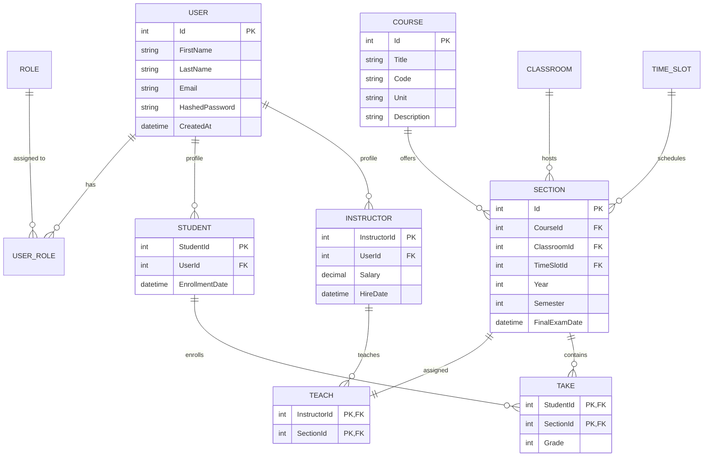

# 🎓 Golestan University Management System (سامانه جامع دانشگاهی گلستان)

[](https://dotnet.microsoft.com/)
[](https://learn.microsoft.com/aspnet/core/)
[](https://learn.microsoft.com/ef/core/)
[](https://www.microsoft.com/sql-server)
[](https://getbootstrap.com/)
[](https://github.com/rastikerdar/vazirmatn)

**Golestan** is an enterprise-grade academic administration and university resource planning (ERP) platform designed for higher education institutions. Built on **ASP.NET Core MVC (.NET 9.0)** and **Entity Framework Core 9.0**, it mirrors the workflows of official state university management portals, delivering comprehensive role-based access, multi-role profile switching, defensive academic conflict detection, and an elegant right-to-left (RTL) design system.

---

## 📑 Table of Contents

- [Architectural Highlights](#-architectural-highlights)
- [Portals & Features](#-portals--features)
  - [1. Security & Identity Management](#1-security--identity-management)
  - [2. Administrator Dashboard](#2-administrator-dashboard)
  - [3. Instructor Portal](#3-instructor-portal)
  - [4. Student Portal](#4-student-portal)
- [Academic Conflict & Scheduling Engine](#-academic-conflict--scheduling-engine)
- [Design System & UI/UX](#-design-system--uiux)
- [Domain Model & Entity Relationships](#-domain-model--entity-relationships)
- [Getting Started](#-getting-started)
  - [Prerequisites](#prerequisites)
  - [Installation & Setup](#installation--setup)
  - [Default Credentials](#default-credentials)
- [Project Directory Structure](#-project-directory-structure)
- [License](#-license)

---

## 🏛 Architectural Highlights

- **Framework**: ASP.NET Core 9.0 MVC with strongly-typed Razor Views and ViewModels.
- **Data Access**: Entity Framework Core 9.0 (Code-First) targeting Microsoft SQL Server / LocalDB with cascade safety and initial seeders.
- **Identity & Access**: Cookie-based Authentication (`MyCookieAuth`) with claims-driven role resolution and server-side profile authorization.
- **Defensive Business Logic**: Strict prevention of schedule collisions, instructor double-booking, classroom overcapacity, and duplicate profile generation.
- **Localization**: 100% native Persian (Farsi) localization with full Right-to-Left (RTL) styling and Vazirmatn typography.

---

## 🌟 Portals & Features

### 1. Security & Identity Management
- **Multi-Role Profile Selection**: A single user account (`User`) can simultaneously hold multiple educational profiles (e.g., student in one program, instructor in another, or administrative staff).
- **Auto-Login vs. Role Picker**: Users with a single role are automatically redirected to their dedicated workspace; users with multiple roles select their active profile via an interactive selector.
- **Privilege Escalation Protection**: Server-side cross-checks verify that the authenticated identity actually owns the requested profile before granting access.
- **CSRF Defense**: All state-modifying requests (`POST`) are protected with `[ValidateAntiForgeryToken]`.

### 2. Administrator Dashboard
- **User & Identity Lifecycle**:
  - Create and manage base user accounts.
  - Issue student registrations with enrollment dates.
  - Appoint instructors with contractual salaries and hire dates.
  - Safe cascade deletion: Deleting users or instructors automatically cleans related course section assignments and enrollments without violating relational constraints.
- **Curriculum & Infrastructure**:
  - Course catalog management (Course code, title, units, and descriptions).
  - Physical classroom inventory (building name, room number, and seat capacity).
  - Weekly time slots (Day of week, precise start time, and end time).
- **Course Section (گروه درسی) Management**:
  - Assemble section offerings binding courses, classrooms, time slots, instructors, semesters, and final exam dates.
  - Change instructor assignment with dynamic availability checks.
- **Enrollment & Roster Operations**:
  - Add students to sections with instant validation of seat capacity and schedule overlap.
  - Manual score / grade modification (0–20 scale).
  - Removal of student enrollments from section rosters.

### 3. Instructor Portal
- **My Sections (`MySections`)**: View all course sections assigned to the logged-in instructor for current and past terms.
- **Roster & Section Details (`SectionDetails`)**: Inspect enrolled student rosters, current scores, and final exam schedules.
- **Grading Workflow (`UpdateGrade`)**: Input and update student exam scores within the official 0 to 20 academic grading scale.
- **Roster Management**: Remove students from the section when administratively required.

### 4. Student Portal
- **Unified Academic Dashboard (`Student/Index`)**:
  - Cumulative Grade Point Average (GPA) computation dynamically calculated over finalized grades.
  - Summary metrics of currently enrolled courses and academic standing.
  - Official transcript table rendering course titles, scores, and pass/fail indicators (Passing threshold $\ge 10$).
  - Clear visual badges for courses awaiting grade submission ("در انتظار نمره").

---

## ⚡ Academic Conflict & Scheduling Engine

Golestan incorporates an academic scheduling engine that enforces strict institutional rules during section creation, instructor assignment, and student registration:

```
                                  [ New Registration / Section ]
                                                │
                 ┌──────────────────────────────┼──────────────────────────────┐
                 ▼                              ▼                              ▼
      [ Time Overlap Check ]       [ Classroom Capacity Check ]     [ Final Exam Check ]
  - Same Day of Week?            - Current Enrolled < Capacity?   - Same Academic Term?
  - Start1 < End2 & Start2 < End1?        (Blocks Overcrowding)     - Same Exam Date?
  - Same Academic Term (Year/Sem)?                                  (Blocks Exam Clashes)
```

1. **Classroom Occupancy Collision**: Prevents scheduling two sections in the same physical room on the same day during overlapping time intervals within the same academic year and semester.
2. **Instructor Double-Booking Collision**: Prevents allocating an instructor to multiple simultaneous classes across conflicting time slots.
3. **Student Schedule Clash**: Evaluates existing course enrollments for the student in the target semester and blocks courses whose times intersect.
4. **Final Exam Collision**: Prevents students from registering for two different courses that have their final examination scheduled on the same calendar day in the same term.
5. **Classroom Capacity Threshold**: Rejects student enrollment once the section's roster reaches the maximum capacity of the assigned classroom.

---

## 🎨 Design System & UI/UX

The interface is crafted using a custom, cohesive academic color palette:

| Color | Hex Code | Purpose |
|---|---|---|
| **Primary Navy** | `#293681` | Main brand identity, top navigation header, table headers, dark badges |
| **Primary Accent** | `#4274D9` | Primary action buttons, focused controls, active highlights |
| **Soft Sky** | `#95CCDD` | Informational cards, auxiliary chips, table borders |
| **Soft Ice** | `#D0E7E6` | Card backgrounds, badge surfaces, subtle component fills |
| **Danger Red** | `#e63946` | Deletion buttons, critical alerts, fail badges |

- **Typography**: Persian **Vazirmatn** font delivered with local and jsDelivr CDN fallbacks.
- **RTL Native**: Built on `bootstrap.rtl.min.css` with dedicated styles in `wwwroot/css/site.css`.
- **Glassmorphism & Micro-Interactions**: Modern login card with backdrop blur, smooth card elevation transitions, and clean badge indicators.

---

## 🗄 Domain Model & Entity Relationships



---

## 🚀 Getting Started

### Prerequisites
- [.NET 9.0 SDK](https://dotnet.microsoft.com/download/dotnet/9.0) or higher.
- [Microsoft SQL Server](https://www.microsoft.com/sql-server) or **SQL Server LocalDB** (included with Visual Studio).
- Modern web browser (Chrome, Edge, Firefox).

### Installation & Setup

1. **Clone the repository**:
   ```bash
   git clone https://github.com/your-username/Golestan.git
   cd Golestan
   ```

2. **Configure Database Connection**:
   Open `appsettings.json` and adjust the connection string to match your SQL Server environment:
   ```json
   {
     "ConnectionStrings": {
       "DefaultConnection": "Server=(localdb)\\mssqllocaldb;Database=GolestanDataBase;Trusted_Connection=True;MultipleActiveResultSets=true;"
     }
   }
   ```

3. **Apply Database Migrations**:
   Run the EF Core migration command to create tables, keys, and initial seed roles:
   ```bash
   dotnet ef database update
   ```

4. **Build and Run the Application**:
   ```bash
   dotnet build
   dotnet run
   ```

5. **Navigate in Browser**:
   Open [http://localhost:5214](http://localhost:5214) or [https://localhost:7279](https://localhost:7279).

### Default Credentials

On initial startup, if the database has no registered users, the system seeder automatically provisions an initial administrator account:

| Role | Email | Password |
|---|---|---|
| **Administrator (مدیر سیستم)** | `admin@golestan.ir` | `admin` |

*(Note: Change the default password upon initial administrative access).*

---

## 📂 Project Directory Structure

```text
Golestan/
├── Controllers/                 # Application MVC controllers
│   ├── AccountController.cs     # Authentication & Multi-Role Picker
│   ├── AdminController.cs       # Administrative Operations & Curriculum
│   ├── HomeController.cs        # Landing and Public Pages
│   ├── InstructorController.cs  # Instructor Dashboard & Scoring
│   └── StudentController.cs     # Student Portal & GPA Calculations
├── Data/
│   └── GolestanContext.cs       # EF Core DbContext & Fluent Mappings
├── Migrations/                  # EF Core Code-First Migrations
├── Models/                      # Core Domain Entities
│   ├── Classroom.cs
│   ├── Course.cs
│   ├── Instructor.cs
│   ├── Role.cs & RoleType.cs
│   ├── Section.cs
│   ├── Student.cs
│   ├── Take.cs & Teach.cs
│   ├── TimeSlot.cs
│   └── User.cs & UserRole.cs
├── Properties/
│   └── launchSettings.json      # ASP.NET Core hosting profiles
├── ViewModels/                  # Dedicated DTOs for forms and views
├── Views/                       # Strongly-typed Razor views
│   ├── Account/                 # Login, Role Picker, Access Denied
│   ├── Admin/                   # Administrative tables and management forms
│   ├── Instructor/              # Teacher sections and grade editing
│   ├── Student/                 # Student dashboard and transcripts
│   ├── Home/                    # Landing portal
│   └── Shared/                  # Layout, Navbars, Partials & Error views
├── wwwroot/                     # Static Web Assets
│   ├── css/site.css             # Comprehensive design system & RTL styles
│   ├── js/site.js               # Client-side scripts
│   └── lib/bootstrap/           # Bootstrap 5 RTL distribution
├── appsettings.json             # Configuration & DB connection strings
├── Golestan.csproj              # .NET 9 project manifest
└── Program.cs                   # Pipeline configuration, DI, and Seeders
```

---

## 📄 License

This project is open-source educational software developed as an Advanced Programming project. Feel free to use, modify, and extend it according to your academic or institutional requirements.
